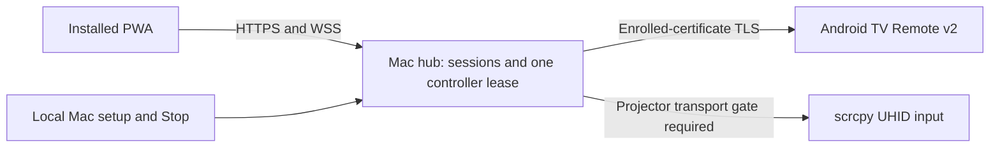

# Local PWA and Mac hub design

Status: accepted for browser-only H1B implementation on 2026-10-24.
The user approved proceeding with design and selected local-only certificate
trust on each controller, without a VPN app or additional account. H0 is PASS.
The owner selected protected projector transport in section 3. No listener,
certificate trust, debugging setting, or dependency has been changed by this design.

## 1. Outcome and limits

One installed phone/laptop PWA combines Home, Back, D-pad/OK, volume, play/pause,
the verified Netflix shortcut, and a relative touchpad. An awake Mac owns both
projector connections. Reuse H0's UHID input and pinned Remote v2 behavior.
Do not revive the failed Android accessibility approach or replace Netflix.

The first product target is one Mac, one explicitly configured XK03H and up to
eight enrolled controllers. Windows hosting, discovery, multiple TVs, remote
internet access, text/voice input, power/wake, screenshots and video streaming
are outside this increment. Bundle all browser resources locally; no telemetry,
remote assets, external accounts, public tunnels, arbitrary shell, package or URL input.

H0 establishes functionality, not secure transport or production reliability.
M0 FAIL and M0.1 STOP remain historical results. The accepted separate hub contract authorizes browser-only H1B work; real device
integration still requires H1A and H1B PASS.

## 2. Approaches and chosen direction

| Approach | Consequence | Disposition |
| --- | --- | --- |
| Local HTTPS with per-install certificate trust | No account/VPN; requires an honest certificate-verification ceremony and stable address | Selected by user |
| Tailscale private HTTPS | Extra app/account and network dependency; could simplify browser certificate trust | Not selected |
| Owned domain with DNS-based public certificate issuance | Domain ownership, renewal and DNS credentials become setup requirements | Not selected for the first increment |

Builder proposal: use one reserved private IPv4 address and port 8443 as the
canonical origin. Do not depend on `.local`, which failed during H0. Require a
DHCP reservation or an owner-managed stable address; do not change router settings
automatically. An address change is an explicit migration and re-enrollment,
not an automatic alternate origin. Same-address leaf renewal preserves the origin.

## 3. Two separate security boundaries; one owner decision

The HTTPS arrow does not secure the second arrow to scrcpy. Legacy wireless ADB
is unencrypted. The working H0 link is a trusted-LAN diagnostic exception.

Read-only observations on the XK03H, 2026-10-24:

- `cmd adb is-wifi-supported` and `is-wifi-qr-supported` returned true.
- `service.adb.tls.port` was blank; no active TLS port was established.
- `android.settings.WIRELESS_DEBUGGING_SETTINGS` resolved no activity; the general
  development settings activity exists. This does not prove pairing impossible.
- The installed host ADB is 37.0.1. Its help offers no mandatory-TLS or peer-pin flag.
- Reviewed AOSP host source accepts any server certificate in its TLS callback.
  The exact installed binary-to-source mapping is not established. Consequently,
  neither a service name nor a successful stock `adb connect` is sufficient evidence
  of enforced encryption and binding to the enrolled projector.

**D1 — decided 2026-10-24: option 1 selected; option 2 not authorized.**

1. **Retain the protected-projector-link requirement (default recommendation).**
   H1A must prove a maintained transport rejects plaintext downgrade and an
   unexpected projector. Investigate supported native pairing first; a physically
   controlled USB link is a separate candidate only after actual OTG/data-port
   support and cable availability are verified. Browser-only H1B work may proceed
   with no device-control backend. If no candidate passes, return to design review.
2. **Explicit trusted-LAN beta exception.** Only if separately approved, retain
   H0's selected legacy ADB link for a local beta while protecting controller-to-hub
   traffic. The projector hop remains unencrypted and vulnerable to LAN interception
   or tampering; this must not be described as end-to-end secure. This changes the
   threat model and acceptance contract. Merely choosing local HTTPS does not approve it.

Do not implement two transport modes in anticipation of this choice. Implement
only the accepted policy. No automatic fallback from an encrypted candidate to
legacy ADB; no automatic daemon restart, root, firmware changes, VPN install or
new projector helper. Never expose the Mac ADB daemon beyond loopback.

## 4. Ownership and reuse

Keep one asyncio loop responsible for enrollment, sessions, leases, connection
state and command admission. Run it in a dedicated thread so Tk dialogs cannot
pause TV heartbeats. The native Mac setup window stays on its UI thread and
exchanges bounded typed messages with the loop. It owns local approval, target
configuration, certificate export, revocation and an always-available Stop.
There is no browser administration API or browser-supplied projector address.

Run blocking pointer I/O in one serialized worker, retaining the synchronous Stop
fence and cleanup release/destroy exception. Preserve the 0.2-second socket
deadline and H0's bounded connection operations. No unbounded executor queue.

Once integration is authorized, move the tested transport modules and their
tests into `hub/device/`; update the H0 caller rather than maintaining duplicate
implementations. Keep the H0 source snapshot/commit and report before moving them.
The product must not import from an experiment directory. Only introduce a device
protocol interface if the no-device gate and real backend both need it.

Proposed responsibility map:

| Path | Responsibility |
| --- | --- |
| `hub/main.py`, `hub/local_ui.py` | Lifecycle and local owner controls |
| `hub/identity.py` | Keychain, certificate issuance, TLS contexts and temporary key-file cleanup |
| `hub/sessions.py` | Enrollment, opaque sessions, revocation; SQLite persistence |
| `hub/server.py` | Exact routes, Host/Origin checks, HTTP/WSS limits and static assets |
| `hub/controller.py` | Single controller lease, sequencing, bounded dispatch and Stop |
| `hub/device/` | Migrated verified Remote v2/UHID adapters and accepted transport policy |
| `web/index.html`, `web/remote.js`, `web/gestures.js`, `web/style.css` | Responsive accessible remote; no UI framework required |
| `web/manifest.webmanifest`, `web/sw.js`, `web/icons/` | Installation and cache-only app shell |
| `tests/hub/`, `tests/web/` | Trust, protocol, lifecycle and gesture regression tests |

Use Python 3.13 and existing cryptography 50.0.2 / androidtvremote2 0.3.2;
retain the pinned scrcpy 5.0.1 server hash. Candidate additions are aiohttp 3.14.5
and keyring 25.7.0. Confirm compatibility, licenses and advisories, and lock all
transitive artifacts with hashes in H1B before installation. These are candidate
selections, not already-accepted dependency ADRs. No Caddy, custom TLS, ASN.1,
custom ECDH/HMAC session protocol, frontend framework or runtime CDN is needed.

## 5. Local certificate trust and secret storage

Use `cryptography` X.509 APIs and Python/OpenSSL TLS. The proposed chain is:

- A per-install root signs exactly one constrained intermediate. Do not persist
  the root private key. Releasing Python objects is not guaranteed memory erasure.
- Persist only the intermediate signing key in the native macOS Keychain. It has
  `pathLen=0`, server-auth scope and critical NameConstraints allowing the exact
  reserved IP `/32` and a random per-install name under `.invalid`. Constrain DNS
  as well as IP; permitting IP alone leaves DNS unrestricted. The reserved DNS
  name is not a discovery mechanism and is not added to the leaf.
- Root/intermediate lifetime: 1,825 days. Leaf: 90 days, renewed with 14 days left,
  never beyond issuer expiry; `notBefore` backdated 24 hours. Leaf SAN contains
  only the selected IP; serverAuth EKU, standard key usages and P-256 keys.
- The intermediate permits ordinary path validation to enforce scope. Do not
  rely solely on constraints on a trusted root, or claim browser enforcement
  before positive and negative certificate tests pass on each supported browser.
- Issuer expiry, loss of the signing key or an address change requires new trust
  and enrollment. “One-time setup” means per installation/address, not perpetual.

Pin the native macOS keyring backend; missing, locked, denied or substituted
backends fail closed. Store Remote v2 client identity and the enrolled peer
certificate there as well. Keychain storage is protection at rest, not
non-exportability or protection from malicious programs running as the Mac user.
Python must access secret bytes to use them; no stronger claim is made.

`SSLContext.load_cert_chain` requires files. Materialize leaf keys only into an
owner-only private runtime directory using exclusive creation and mode 0600,
load the context, then unlink promptly. On startup clean only this application's
owned temporary files, with symlink-safe checks. Unlinking is not secure erasure.
No private keys in the repository, logs, QR codes, URLs or diagnostic exports.

Certificate trust is not restricted to this app, port 8443 or the home network:
the same private IP may exist on another network. Explain this during setup.
Retire the old root on every enrolled device after migration, compromise, key
loss or uninstall; revoke old sessions and remove the old Keychain identity.
A migration is incomplete until old trust removal is acknowledged. No silent
creation of accumulating trusted roots.

Export the root certificate locally, with its full SHA-256 fingerprint displayed
in the trusted native Mac window. Transfer the certificate via an owner-selected
file-transfer method. Do not add an HTTP download/fingerprint server. The owner
must verify the installed certificate against the Mac before enabling trust.
Demonstrate that verification on the actual phones; if their UI cannot support
it, H1B stops for a revised ceremony. Browser JavaScript cannot attest to the TLS
certificate it received, and an application fingerprint is not a relay defense.

iOS requires certificate installation and a separate full-trust setting. After
trusted HTTPS works, install the PWA and enroll from inside the installed app.
Do not assume Safari and installed-PWA storage are shared. Use OS-managed clocks;
wrong-clock/expired-certificate errors require correction, not validation bypass.

## 6. Enrollment and authorization

The native Mac owner opens a 120-second enrollment window. At most four pending
requests exist. The installed PWA submits a display label of at most 32 characters
to `POST /api/enroll/request`. The hub issues a random 256-bit pending cookie and
a CSRF token, and displays a unique six-digit comparison code in both interfaces.
The code is a human comparison aid, not a password or cryptographic trust anchor.
Only the native owner can approve the matching pending request.

The requesting PWA polls `POST /api/enroll/complete` at most once per second using
its pending HttpOnly cookie and CSRF token. Approval is bound to that exact pending
session, consumed atomically once, and expires with the enrollment window. No
cookie is issued to a different pending session even if labels/codes are copied.
Anonymous enrollment attempts are limited globally to four per open window;
closing/reopening requires a native action. LAN grief/DoS remains a stated limit.
Pending cookies use the same Secure/HttpOnly/SameSite/Path constraints as sessions
and expire after 120 seconds. Reload of a pending enrollment discards it and
starts a new request; native cancellation frees its pending slot. If approval
commits but the cookie response is lost, the orphan consumes a controller slot.
The owner revokes that enrollment locally and approves a fresh request; do not
recover or resend a token whose plaintext was discarded.

An approved controller receives an opaque 256-bit token in `__Host-ott_session`:
Secure, HttpOnly, SameSite=Strict, Path=/, no Domain, 30-day absolute expiry.
Persist only its SHA-256 hash, expiry, revocation and display label in owner-only
SQLite storage. No JWT, localStorage bearer token, session token in URL, or
custom browser signing protocol. Display labels are untrusted plain text.

Native revocation takes effect before the next command admission and closes
existing sockets; all-controller revocation is available locally. After restart,
valid cookies may authenticate, but every control lease and sequence is new.
Compromised/cleared browser storage requires revocation/re-enrollment.
Absolute session expiry is enforced by a timer and before every admission;
it stops owned work and closes that session's sockets even if heartbeats continue.
A session owns one in-memory CSRF token per hub boot; GET /api/session returns
that token without rotating it out from under another tab. Clear it on expiry
or revocation. Pending enrollment has a separate token.

## 7. Network surface and protocol

Bind HTTPS only to the configured private IPv4 at port 8443, never wildcard or a
public address. TLS minimum 1.2 with maintained defaults and no debug key logging.
Reject an unexpected Host authority; reject missing, null or non-exact Origin
on state-changing requests and WSS. No CORS, forwarded-host trust or redirects
to caller-supplied URLs. No HTTP control listener.

| Method / path | Access and behavior |
| --- | --- |
| GET `/`, `/remote.js`, `/gestures.js`, `/style.css`, `/manifest.webmanifest`, `/sw.js`, explicit icon paths | Bundled static allowlist; no directory browsing/path interpolation |
| POST `/api/enroll/request` | Open native enrollment window, exact Origin, JSON body |
| POST `/api/enroll/complete` | Pending cookie plus matching CSRF token and native approval |
| GET `/api/session` | Enrolled cookie; returns boot-scoped session CSRF token and minimal status; no-store |
| POST `/api/logout` | Session and CSRF; revoke own session, stop own lease, clear cookie |
| GET `/ws` upgrade | Enrolled cookie and exact Origin; no query credentials |

All API responses are no-store. CSRF tokens are returned only through same-origin
responses and checked on state changes. WSS requires a first JSON hello containing
protocol version 1 and the session-bound CSRF token within three seconds; no input
is admitted before it succeeds. Unknown fields, duplicate keys, binary frames,
invalid enum values and nonfinite/non-integer numeric inputs are rejected.

After hello, messages contain version, positive monotonic sequence, kind and
only that kind's fields. Input messages also carry the server-issued random lease
ID. Closed kinds: take_control, release_control, stop, connect, key, netflix,
move, press, release, tap, scroll, heartbeat. Keys are H0's existing fixed enum;
Netflix maps only to `nflx://www.netflix.com/browse` inside the adapter. Move axes
are integers in [-256,256]; scroll axes are integers in [-1,1] with H0's existing
button-direction semantics. No command carries a target, raw URL or package.

One active controller, one lease. Ownership is the tuple (session, socket,
random lease generation); sequences start at one and increase exactly by one
per authenticated socket. Heartbeat, release_control, connect and every input
require that exact owner and lease. A second tab shares enrollment but cannot
renew or release another socket's lease. Old socket closure affects only its
own generation. Take control is explicit. A second controller
receives busy; it cannot steal the lease. The current owner can release it, or
the native owner can Stop to make it available. Enrolled controllers may issue
Stop without owning the lease. Connect targets only locally configured devices,
only when the lease is owned, with the accepted transport policy and bounded
operations. No automatic input replay or automatic takeover on reconnect.

Each ack means admitted, dispatched, or failed, with its input sequence; dispatched
means sent to the device channel, not that Netflix visibly acted. UI copy must
not equate a successful write with observed app activation.

Limits: eight enrolled controllers, eight authenticated WSS connections, four
pending enrollment requests, 4 KiB request/frame limit, eight queued controls,
one coalesced movement slot, 30 Hz movement dispatch, 60 inbound frames/second
with a 120-frame token-bucket burst. Apply these per active session and retain a
total budget of 32 accepted connections including unauthenticated/TLS-handshake
connections; require a verified server admission mechanism in H1B, not merely
an HTTP handler semaphore. TLS handshakes and incomplete HTTP headers have a
five-second deadline. Exhaustion rejects new connections without allocating an
unbounded waiting queue. Disable WebSocket compression. Await
writes; cap each socket's pending output at 32 KiB and stop its active lease on
a 200 ms write deadline/overflow. Heartbeats every second; expire the lease after
three seconds without application heartbeat. H0 pointer drag deadlines remain
two seconds idle and fifteen seconds total.

Stop, revocation, active-controller loss, page backgrounding, device-channel
failure, queue overflow and version mismatch invalidate queued work and fence
new sends. Cleanup release/destroy is still allowed. An in-flight OS write cannot
be retracted. Host wake requires explicit reconnect and fresh lease, never replay.
An inactive observer disconnect must not stop someone else's active lease.
Stop also invalidates in-flight connect operations: cancel tasks and check the
captured generation after every asynchronous boundary. Late completion disposes
only its owned resources and never publishes connected state or stops a successor.

A hub crash cannot run its release watchdog. H2 must measure held-input behavior
on process kill, host sleep and link loss; do not claim the browser heartbeat
provides device-side crash cleanup. Reconnect requires old owned input resources
to be closed/destroyed and a fresh neutral-button report before lease admission.
If old ownership/cleanup cannot be established, fail closed and show recovery
instructions. Never kill unrelated ADB/scrcpy sessions. No bounded crash-release
claim is accepted without device evidence; any persistent held input blocks H2
pending a concrete recovery/transport design decision.

## 8. PWA behavior

Single responsive screen: connection state, TV buttons, Netflix, touchpad,
scroll buttons, local sensitivity slider, Take control and Stop. Preserve native
button semantics, keyboard access, visible focus, readable status and useful
accessible names. The Mac setup window remains the owner/admin surface.

One-finger motion moves the relative cursor; a short tap clicks. Hold for 300 ms
without more than six CSS pixels of movement to begin dragging, then release on
pointerup/cancel. Two fingers scroll with bounded wheel steps; beginning a
two-finger gesture cancels pending click/hold recognition, releases any active
drag before the first scroll message, and suppresses a trailing tap. Mouse behavior follows
H0: hover moves, held button drags. Keep explicit scroll buttons available.
Sensitivity affects client-side delta scaling; server bounds still apply. No
new remote sensitivity command. Preserve fractional deltas before quantization.

On visibility loss, touchcancel, pointer capture loss or socket loss, cancel all
recognizers and request release/Stop when possible. The server's deadline remains
authoritative when the browser is suspended. No vibration/audio permission needed.

The service worker caches only versioned static shell assets. Never cache API
responses, device state or commands; never use Background Sync for controls.
Offline means controls disabled. Protocol mismatch stops input and displays
Reload to update; do not activate a new worker halfway through an active gesture.

## 9. Threat model and remaining limits

Protect against unpaired LAN clients, cross-origin web pages, wrong TLS peers,
replayed/stale application input, malformed/flooded requests and revoked sessions.
Browser certificate trust protects served code; application pairing cannot repair
a wrongly trusted root or compromised hub. A paired compromised controller can
control the TV until revoked. Same-user Mac malware, physical access and volumetric
network denial-of-service are outside this increment's protection claims.

Root/intermediate path constraints, Keychain behavior, installed-PWA persistence
and browser lifecycle behavior need actual gate evidence. Native ADB capability
flags and an advertised TLS service are not projector authentication evidence.
The legacy ADB beta exception is absent unless D1 is explicitly approved.

## 10. Acceptance and implementation order

1. **H1A: projector link decision/feasibility.** Record firmware onboarding and
   exact transport/version evidence. Prove enrollment, unexpected-peer rejection,
   no plaintext fallback and behavior after reconnect. Otherwise hold real pointer
   integration, or obtain an explicit, separately documented trusted-LAN beta exception.
2. **H1B: browser trust/auth gate, no projector backend.** Verify certificate
   installation/fingerprint ceremony, Safari and installed iPhone PWA, Android
   Chrome and installed PWA, and laptop Safari/Chrome. Record actual OS/browser
   versions. Test wrong root/IP/expired/out-of-scope certificates, same-address
   renewal, address migration, Keychain denial, fake Origin/Host, enrollment races,
   cross-session completion, revocation, limits and stale worker updates.
3. **H2: one end-to-end remote.** Only after H1B and the accepted H1A policy:
   migrate tested adapters, integrate one lease, and repeat H0's functional checks
   through each supported browser. Add active-drag Stop, Wi-Fi loss, host sleep,
   browser backgrounding and restart tests. Preserve physical-remote operation.
4. **H3: distribution.** macOS packaging/signing and installation/troubleshooting
   docs; security review, dependency lock audit and release boundary checks. Windows
   hosting remains a separate later milestone, not implied by a portable language.

No unsupported test is a PASS. No runtime fallback or widened CA scope is added
to make a gate pass. Do not implement product device control until H1A and H1B pass.

## Design review disposition (2026-10-24)

Independent builder and security reviews identified socket lease ownership,
late connection completion after Stop, active-socket session expiry, and
release-before-scroll gaps. Sections 6–8 now define each invariant. Builder
questions on orphan enrollment, crash cleanup and certificate scope/retirement
are also resolved above. Browser and hardware claims remain gates, not inferred
passes. D1 is resolved in favor of protected transport. Feasibility remains unproven.

## Sources and research qualification

- [AOSP ADB Wi-Fi architecture](https://android.googlesource.com/platform/packages/modules/adb/+/HEAD/docs/dev/adb_wifi.md): legacy TCP versus newer TLS pairing.
- [AOSP host TLS implementation](https://android.googlesource.com/platform/packages/modules/adb/+/refs/heads/main/transport.cpp): reviewed host verification callback; not an audit of the installed binary.
- [RFC 5937](https://www.rfc-editor.org/rfc/rfc5937.html): trust-anchor constraint caveat; verify intermediate-path behavior separately.
- [Apple manual certificate trust](https://support.apple.com/en-us/102390): separate installation and full-trust step.
- [keyring security considerations](https://keyring.readthedocs.io/en/stable/): same-Python-executable access is not per-app isolation.
- [Python SSLContext](https://docs.python.org/3.13/library/ssl.html#ssl.SSLContext.load_cert_chain): file-based private-key loading.
- [aiohttp server reference](https://docs.aiohttp.org/en/stable/web_reference.html): maintained HTTPS/WSS implementation and explicit resource limits.
- [OWASP WebSocket security](https://cheatsheetseries.owasp.org/cheatsheets/WebSocket_Security_Cheat_Sheet.html): Origin, session, schema and lifecycle checks.
