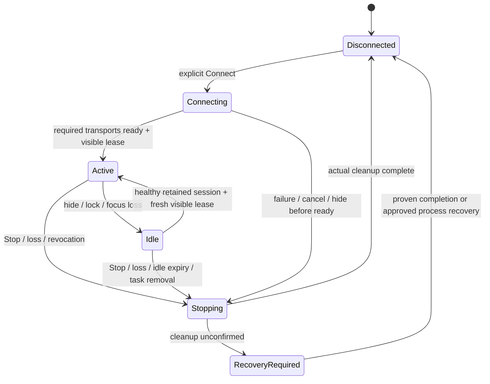

# Nord daily-use readiness — N4 lifecycle design

Status: APPROVED by the owner (2026-10-27), “go ahead”. Preparation snapshot: `da568d4` / accepted0.20.
Fetched merged main `12664b4` has an identical source tree.
The owner selected “Keep an idle background connection for faster return; input
only while the remote is visible”. That direction is selected; the concrete
lifecycle/duration changes below are approved targets, not shipped behavior.

## Goal and scope

A reliable private Nord AC2001 / Android12 remote for the XGIMI: use beyond five
minutes, preserve already authenticated links during short app switches/lock,
return quickly, and always retain a usable Stop/recovery path. Keep the0.20 UI,
Bluetooth HID pointer/scroll and pinned-TLS Android TV Remote v2 controls.

This is a new Nord readiness contract. It does not promote original M0/M1 or
H1A/H1B gates, authorize a projector accessibility backend, or add a Mac/iPhone/
Windows bridge, LAN listener, cloud, accounts, discovery or new TV commands.
Initial pilot keeps the current module, app ID, signing identity, Keystore alias,
enrollment formats/paths and backup exclusions. No uninstall/data clear or silent
trust restoration. Public release/signing and wider-device certification are later.

## Approach and alternatives

1. **Selected direction: service-owned retained connections, visible-only input.**
   This meets the owner’s background choice. It requires explicit separation of
   transport lifetime from UI input authorization and actual Nord platform proof.
2. Foreground-only disconnection is simpler but was not selected; do not silently
   substitute it if background retention fails.
3. Simply extend the timer or remove Activity pause cleanup is rejected: current
   Activity.Run captures views/Activity state and its TV writer has no visibility
   epoch. That would retain stale owners or permit queued input after hiding.

## Proposed observable policy

The owner approved these lifecycle defaults with this design:

- One saved projector and one established session. Existing manual enrollment
  and exact peer/certificate/key checks remain; no automatic pairing or new peer.
- A single **Connect** starts a saved-session attempt from a visible/unlocked UI;
  Stop ends it. Normal use no longer exposes diagnostic Start. Setup still uses
  explicit bounded setup actions, with copy updated from the diagnostic workflow.
- Active visible use has no five-minute session cap. Existing phase, liveness,
  queue, rate and I/O deadlines remain independent and bounded.
- App switch, window-focus loss, lock, screen-off or entering Setup immediately
  revokes user-input eligibility. Already established links may remain idle for
  **30 minutes**, measured with elapsed realtime, with an ongoing notification.
  Set that deadline at the first loss of eligibility; repeated hide/focus events,
  protocol maintenance and status callbacks do not extend it. Only a healthy,
  eligible return before expiry ends idle; a later loss starts a new idle period.
- Hiding during an unfinished control connection cancels it. Only already ready
  connections may enter retained idle; the bounded Bluetooth setup-dialog
  exception below does not authorize hidden control connection attempts.
- Returning before expiry to a resumed, focused, interactive, unlocked Remote or
  Touchpad surface grants a fresh input epoch only if the same session/peer is
  still healthy. A fresh finger-down is required; queued input is never replayed.
  This resumes an existing link, not a new connection attempt.
- Stop, idle expiry, either link’s failure, permission loss, bond/certificate
  revocation, task swipe-away or service/process death ends the session. Both
  channels fence input; return requires explicit Connect after proven cleanup.
  No boot-start, sticky restart, automatic reconnect or retry loop.
- Back/home/app switching enter idle while the task remains; swiping the task
  away is Stop. Verify actual Android task behavior rather than assuming callbacks.
- Notification offers **Open remote** and **Stop**, including while locked.
  Neither notification action may issue TV keys, movement or clicks. Service is
  non-exported and starts only from the user’s visible Connect/setup action.
- No wake lock, battery-optimization bypass or keep-screen-on by default. OEM
  suspension may lose a connection; the app reports it and requires Connect.
- Pairing remains attended and separately bounded: existing five-minute setup
  ceiling,120-second discoverability/code-entry windows and current protocol
  phase bounds remain. TV pairing cancels/clears code on UI loss; the existing
  pre-confirmation Bluetooth system-dialog exception remains setup-only.

## Ownership and admission

Promote the existing eligibility-only service to **RemoteConnectionService**, a
non-exported connectedDevice foreground service, and extract **RemoteRuntime**
from Activity.Run. Keep the app ID; replacing an internal component must not
change enrollment identity. Update the manifest/notification target atomically.
The service/runtime owns Bluetooth profile/registration callbacks, TV workers,
receivers, enrollment access, cleanup gate and clocks. It holds no Activity/view
references. ProbeActivity renders immutable snapshots and submits closed requests.
No second runtime or retained static Activity is introduced.

Two independent authorities:

- **Transport session:** current NativeRunGate owner, generation, enrolled peer,
  native registration/connection and optional valid TV connection.
- **Input visibility lease:** current bound Activity attachment plus UI epoch;
  resumed AND focused AND screen interactive AND unlocked AND Remote/Touchpad
  visible. Only the current owner may grant/revoke it. Stale UI binders/views and
  older epochs cannot authorize input or mutate a newer owner.

Input admission rechecks both at submission and immediately before user-command
writes/reports. Visibility loss revokes the lease synchronously without waiting
for I/O, cancels pad/scroll/tap state and drops unsent TV commands. Mouse click
release remains in finally; a strictly release-only neutral report may be sent
for safety. No movement/click/scroll/key is admitted while idle. Transport ping/
status replies may maintain an existing link, but cannot grant input.

Bytes/reports handed to the transport before revocation cannot be recalled.
Do not promise retroactive cancellation. If a user frame is partially written or
its completion is uncertain at the visibility boundary, fence and close that
session instead of continuing a partially sent command; explicit Connect follows
only after the existing cleanup proof. Do not hold a UI/main-thread lock over I/O.

Session lifetime and input authorization are separate from protocol liveness:
keep TV12-second initial connection,10-second negotiation phases,120-second code
window,30-second valid-peer liveness,2-second write bound,250ms user-command age,
100ms key-admission spacing, eight reply slots and current gesture30Hz/±127/
bounded accumulation. Renewing idle retention must not extend handshake/write or
stalled-peer deadlines. Monotonic expiry is rechecked after sleep and before reuse.

## Platform and cleanup gates

Official BluetoothHidDevice docs require foreground eligibility and actual
registration callbacks; command-return true is not registration/unregistration
completion. AOSP source uses importance200 cutoff; foreground service importance
125 supports feasibility. Neither proves Nord lock/Doze/OEM survival or idle TLS
health. Prove those on the Nord before claiming retained background connectivity.

The captured Bluetooth interruption lacks selected DISCONNECTED and UNREGISTERED
acknowledgments. Keep NativeRunGate’s failed latch and actual-resource completion
contract. Do not substitute elapsed time, ON/BLE_ON, detached-proxy defaults or
new UI for cleanup evidence. A code-only timer reset is not an acceptable fix.

First investigate callback retention/cleanup ordering while preserving native
proof. If this cannot resolve stack-shutdown loss, produce a separate concrete
completion/recovery proposal with its platform evidence for owner approval.
Process isolation/Binder death is a research candidate, not selected architecture
or an assertion that cleanup completed. Force stop/reopen remains the current
explicit recovery instruction until a replacement is proven. Daily-use readiness
is BLOCKED while ordinary Bluetooth interruption still needs that workaround.

## Owner-approved Nord background-policy opt-in (2026-10-29)

On the tested Nord/API31 build AC2001_11_F.24, system logs show OnePlus Hans
freezing Open TV approximately30seconds after Home despite its started
foreground service, with the screen awake. Return unfreezes the process and
its expired TV-control channel fails at CONTROL_EXCHANGE. The owner explicitly
approved enabling **Allow background activity** for Open TV only under App info
→ Battery usage, leaving **Allow auto launch Off**, and repeating the same test.

This optional/reversible system setting is the sole approved policy exception.
Do not add an app-requested/global exemption, wake lock, boot start or automatic
reconnection. Existing visible-input, trust, liveness and cleanup requirements
remain. Background activity may increase battery use; exact-artifact Home-return,
lock,30-minute retention/expiry and unplugged endurance still need evidence.
See [trial report](../../gates/n4-home-return-report.md).

## Delivery and acceptance gates

1. **R0 — trustworthy verification/recovery evidence.** Diagnose the full-suite
   TLS close-read assertion using actual return/exception/timing. EOF remains a
   hypothesis until captured. Preserve the100ms blocked-read and2s close/join
   bounds; a test correction may accept only confirmed EOF/close exception, never
   returned data, premature completion, timeout or worker leaks. Resolve Bluetooth
   recovery under the existing proof or separately approve replacement evidence.
2. **R1 — ownership extraction, unchanged behavior.** Move lifetime/callbacks to
   the service/runtime while retaining the five-minute pause-stop diagnostic.
   Update actual-method lifecycle/cleanup tests, not only pure helper mirrors.
3. **R2 — visibility/idle kernel.** Add UI epochs, snapshot-only binding and the
   agreed lifetime policy. Prove pause/focus/lock/detach, stale callbacks, queued/
   in-flight writes, neutral release, new-down, Stop and deep-sleep expiry.
4. **R3 — controlled retained-link proof.** Reviewed same-signature pilot only;
   preserve actual enrollment. First a short home/lock/return check inside a
   bounded session, then30-minute hidden retention/expiry and visible use beyond
   five minutes. No input tests run automatically in the background.
5. **R4 — private daily-use pilot.** All checklist gates green, including recovery,
   update continuity, revocation and failure tests. A documented two-hour active
   soak and background battery/thermal observation precede owner pilot acceptance.
   Show accurate user copy/name instead of “five-minute probe”, while release
   distribution remains disabled. No full daily-use claim while any gate is open.

R1 can be prepared with unchanged behavior while R0 investigation runs. R2/R3
experiments remain explicitly unaccepted until recovery and platform gates close.
The planned cleanup decision is not silently granted by approving this lifecycle.

## References and baseline

- Official HID API: https://developer.android.com/reference/android/bluetooth/BluetoothHidDevice
- Foreground-service restrictions: https://developer.android.com/develop/background-work/services/fgs/restrictions-bg-start
- connectedDevice type: https://developer.android.com/develop/background-work/services/fgs/service-types#connected-device
- [Protected-link research](../../research/2026-10-24-protected-wireless-options.md)
  and [N3 evidence](../../gates/n3-report.md): observed callback loss and existing
  recovery contract.
- Installed0.20: sourceed26031;176unit/26focused native checks; owner accepted
  normal UI/use. Those are historical evidence, not N4 background certification.
